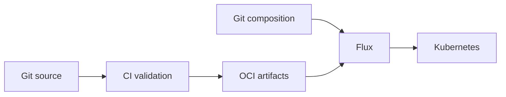

I do not want to rebuild an observability stack every time it moves to another environment. I want to identify what was validated and then decide where to deploy it.

In my July article about GitOps versions, I separated application images from infrastructure packaging. I want to take that separation further: the Git repository does not have to be the product consumed by a cluster.

## Three responsibilities

Git holds source and composition decisions. An OCI registry distributes built components. Flux reconciles the selected composition.

A platform may contain a Gateway API controller, an OpenTelemetry collection stack and a policy engine. These components evolve independently. A collector change should not require rebuilding the network.

## The contract I want

Each module has a readable version, a digest, dependencies and readiness criteria. A composition references modules and allowed parameters. Changing versions becomes an explicit decision rather than an implicit rebuild.

A digest identifies package content, not the final state of two clusters. Admission policies, API versions and local configuration can differ.

## Reproducible experiment

Build a package containing a ConfigMap and a Deployment, publish it to a test registry and select the same digest in two Kind clusters. Compare the digest reported by Flux, desired objects and observed state. Introduce an admission mutation to demonstrate the boundary of the contract.

This is a proposed experiment, not a benchmark result.

## Field experience: an AKS monitoring hub

We published eight independent packages in GHCR: VictoriaMetrics and CNPG operators, VictoriaMetrics, Grafana database, Grafana, Loki, Alloy and common resources. Packages contain Kubernetes manifests, including HelmRelease objects, not runtime images. Package publication is complete; bootstrap and operational tests still need validation.

## What I want reviewed before publishing

A publication PR should expose the build output, not only the source diff. A helper change can alter dozens of resources without the chart diff identifying them. I want an inventory of added, changed and removed objects, a generated manifest diff and validation results. The published package must contain the checked files, without rendering again between validation and upload.

Our current architecture still packages some HelmRelease objects. Those packages can be checked as Flux declarations, but Helm's output requires another validation step.

## Sources

- [Flux OCIRepository](https://fluxcd.io/flux/components/source/ocirepositories/)
- [OCI Distribution Specification](https://github.com/opencontainers/distribution-spec)
