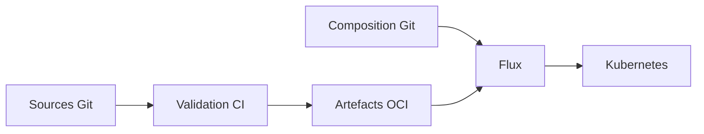

Je ne veux pas reconstruire une stack d'observabilité chaque fois qu'elle change d'environnement. Je veux pouvoir identifier ce qui a été validé, puis décider où le déployer.

Dans mon article de juillet sur les versions GitOps, je séparais déjà les images applicatives du packaging de l'infrastructure. Je voudrais pousser cette séparation plus loin : le dépôt Git n'est pas obligatoirement le produit que le cluster doit consommer.

## Trois responsabilités

Git porte les sources et les décisions de composition. Le registre OCI distribue les composants construits. Flux réconcilie la composition sélectionnée.

Prenons une plateforme avec un contrôleur Gateway API, une stack de collecte OpenTelemetry et un moteur de politiques. Ces composants évoluent à des rythmes différents. Un changement de collecteur ne devrait pas obliger à reconstruire le réseau.

## Le contrat que je veux obtenir

Chaque module possède une version lisible, un digest, des dépendances et des critères de disponibilité. Une composition référence les modules et leurs paramètres autorisés. Un changement de version devient une décision explicite, pas une reconstruction implicite.

Le digest identifie le contenu du paquet. Il ne garantit pas que deux clusters produisent le même état final : politiques d'admission, versions des API et configuration locale peuvent diverger.

## Expérience à reproduire

Construire un paquet contenant un ConfigMap et un Deployment, le publier dans un registre de test, puis sélectionner le même digest dans deux clusters Kind. Comparer le digest rapporté par Flux, les objets désirés et l'état observé. Introduire ensuite une mutation d'admission pour montrer la limite du contrat.

Ce protocole est proposé, pas un résultat de benchmark.

## Un cas concret : un hub de monitoring sur AKS

Sur une plateforme Azure, nous avons préparé huit paquets indépendants : opérateur VictoriaMetrics, VictoriaMetrics, opérateur CNPG, base Grafana, Grafana, Loki, Alloy et ressources communes. Le contenu distribué est un dossier de manifests, qui peut encore contenir des HelmRelease. Les images exécutées par les workloads suivent leur propre cycle.

Les huit paquets ont été publiés dans GHCR sous un tag dédié au nouveau hub. Ce que je peux affirmer à ce stade est la publication des artefacts et la préparation du déploiement, pas la validation opérationnelle du hub en production.

## Sources

- [Flux OCIRepository](https://fluxcd.io/flux/components/source/ocirepositories/)
- [OCI Distribution Specification](https://github.com/opencontainers/distribution-spec)
