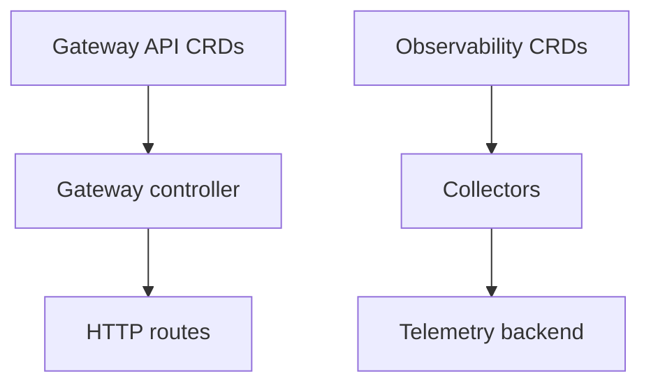

I prefer a component catalog with clear responsibilities to a giant chart containing the entire platform. Boundaries should follow lifecycles, not just technical categories.

## The module as a contract

A module exposes a version, inputs, provided APIs, consumed APIs and a readiness criterion. A profile composes modules without merging them into a single release.

Distinguish the build DAG from runtime readiness. Moon can orchestrate rendering, validation and packaging with caching when all relevant inputs are declared. Flux handles reconciliation dependencies. A completed build does not prove an API is ready to serve.

## Configuration and compatibility

Minimal and production profiles may share modules while varying capacity and parameters. Secrets stay out of public bundles. Test contract changes against consumers and supported Kubernetes versions.

## Reproducible experiment

Create CRD and controller modules and two profiles. Change only the controller. Observe which Moon tasks are invalidated and which artifacts change. Remove a cache input to demonstrate why dependency declarations matter.

## The hub catalog

The eight AKS hub packages are independent. The cluster directory composes sources and Kustomizations; retention, storage and DNS parameters are injected per environment. Operators precede their managed resources. The proposed Moon build DAG is distinct from the Flux orchestration already prepared.

## Sources

- [Moon task configuration](https://moonrepo.dev/docs/config/project)
- [Flux Kustomization](https://fluxcd.io/flux/components/kustomize/kustomizations/)
