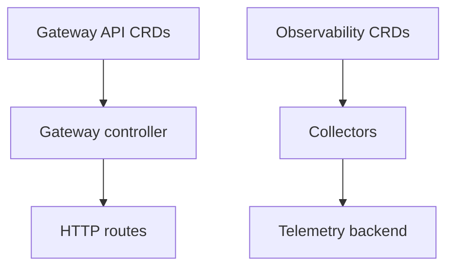

Je préfère un catalogue de composants avec des responsabilités claires à un chart géant qui contient toute la plateforme. Le découpage doit suivre les cycles de vie, pas seulement les catégories techniques.

## Le module comme contrat

Un module expose une version, ses entrées, les API qu'il fournit, les API qu'il consomme et un critère de disponibilité. Un profil compose plusieurs modules sans les fusionner dans une seule release.

Je distingue le DAG de construction du graphe de disponibilité au runtime. Moon peut orchestrer les tâches de rendu, validation et packaging, avec cache si toutes les entrées pertinentes sont déclarées. Flux gère les dépendances de réconciliation. Un build terminé ne prouve pas qu'une API est prête à servir.

## Configuration et compatibilité

Un profil minimal et un profil production peuvent partager les mêmes modules tout en variant la capacité et les paramètres. Les secrets restent hors des bundles publics. Les changements de contrat sont testés contre les consommateurs et les versions Kubernetes supportées.

## Expérience à reproduire

Créer deux modules, CRDs et contrôleur, et deux profils. Modifier uniquement le contrôleur. Vérifier quels travaux Moon invalide et quels artefacts changent. Retirer une entrée du cache pour démontrer pourquoi la déclaration des dépendances importe.

## Sources

- [Moon task configuration](https://moonrepo.dev/docs/config/project)
- [Flux Kustomization](https://fluxcd.io/flux/components/kustomize/kustomizations/)
