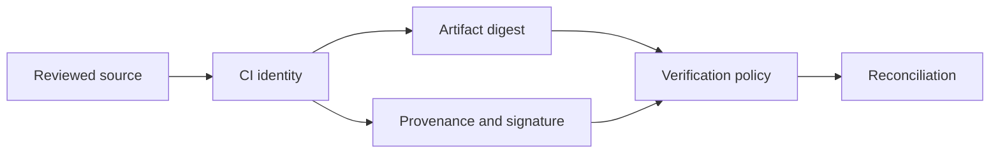

Signing an infrastructure package is not enough. I want to know who built it, from which inputs, and why the cluster accepts it.

## Identity and provenance

CI publishes with a dedicated identity and limited permissions. Federated identity can avoid persistent secrets where the registry supports it. Provenance links a digest to sources and the build process. A signature associates content with a trusted identity.

The policy must check more than signature presence: expected identity, issuer, authorized repository and workflow according to the trust model. Bundle verification and verification of referenced images are different controls.

## Evidence is not assurance

An SBOM can inventory dependencies where its format and scope allow it. It does not prove the absence of vulnerabilities. A SLSA attestation does not automatically establish a SLSA level. Manifests also need checks for privileges, secrets and image references.

## Reproducible experiment

Sign a package with an authorized test identity, verify acceptance, then publish an unsigned package or one signed by another identity. Verify rejection and error visibility. Separately test a noncompliant image referenced by a compliant bundle.

## Publisher and consumer identities

In the GHCR case, the publishing workstation uses an identity with write:packages. The cluster uses a separate Docker secret limited to package read access, with Flux generic provider. Source and revision annotations link the package to its Git SHA but do not replace signed attestations. Secrets are excluded from the bundle. Cryptographic verification and admission policies are extensions of the chain, not controls I claim to have deployed here.

## Useful attestations describe the checks performed

The proposed publication chain associates the OCI digest with validation of the files actually packaged: schemas including CRDs, policies, image inventory and integration tests. Reports must not claim tests that were not run. Distinguish package build evidence, rendered composition validation and runtime observations.

Security policies should inspect generated manifests: privileged containers, hostPath mounts, RBAC permissions, unpinned images, network exposure and cleartext secrets. A HelmRelease alone does not reveal all these properties. Render and inspect its resources or explicitly limit the scope of the report.

## Sources

- [Sigstore Cosign](https://docs.sigstore.dev/cosign/)
- [SLSA specification](https://slsa.dev/spec/)
- [Flux OCIRepository](https://fluxcd.io/flux/components/source/ocirepositories/)
