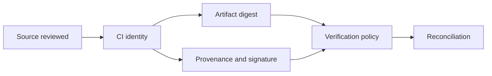

Signer un paquet d'infrastructure ne suffit pas. Je veux savoir qui l'a construit, à partir de quelles entrées, et pourquoi le cluster accepte de le consommer.

## Identité et provenance

La CI publie avec une identité dédiée et des permissions limitées. Lorsque le registre le permet, une identité fédérée évite les secrets persistants. La provenance relie le digest aux sources et au processus de construction. Une signature associe le contenu à une identité de confiance.

La politique doit vérifier davantage que la présence d'une signature : identité attendue, émetteur, dépôt et workflow autorisés selon le modèle retenu. La vérification du bundle et celle des images référencées sont deux contrôles différents.

## Ne pas confondre preuve et assurance

Un SBOM peut inventorier les dépendances lorsque le format et le périmètre le permettent. Il ne constitue pas une preuve d'absence de vulnérabilité. Une attestation SLSA ne donne pas automatiquement un niveau SLSA. Les manifests doivent aussi être contrôlés pour les privilèges, les secrets et les références d'images.

## Expérience à reproduire

Signer un paquet avec une identité de test autorisée, vérifier son acceptation, puis publier un paquet non signé ou signé par une autre identité. Vérifier le refus et la visibilité de l'erreur. Tester séparément une image non conforme référencée par un bundle conforme.

## Identités de publication et de consommation

Dans le cas GHCR, le poste de publication utilise une identité disposant de write:packages. Le cluster utilise un secret Docker distinct, limité à la lecture des packages, avec le provider generic de Flux. Les annotations source et revision relient le paquet à son SHA Git mais ne remplacent pas une attestation signée. Les secrets ne sont pas intégrés au bundle. La vérification cryptographique et les politiques d'admission sont des extensions de la chaîne, pas des contrôles dont je revendique ici le déploiement.

## Une attestation utile décrit les contrôles effectués

La chaîne de publication proposée associe au digest OCI le rapport de validation des fichiers réellement packagés : schémas incluant les CRDs, politiques, inventaire des images et tests d'intégration. Un rapport ne doit pas prétendre couvrir des tests non exécutés. Je distingue la preuve de construction du paquet, la preuve de validation des compositions rendues et les observations runtime.

Les politiques de sécurité doivent lire les manifests générés : containers privilégiés, montages hostPath, droits RBAC, images non épinglées, exposition réseau et secrets en clair. Une HelmRelease seule ne révèle pas toutes ces propriétés. Il faut rendre et inspecter ses ressources ou limiter explicitement la portée du rapport.

## Sources

- [Sigstore Cosign](https://docs.sigstore.dev/cosign/)
- [SLSA specification](https://slsa.dev/spec/)
- [Flux OCIRepository](https://fluxcd.io/flux/components/source/ocirepositories/)
