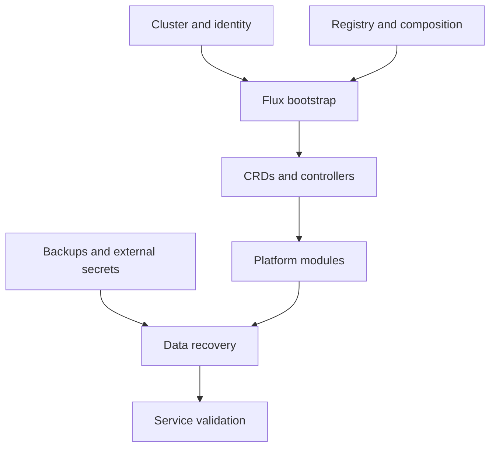

A well-organized Git repository is not a disaster recovery plan. I want to rebuild a platform on a new cluster and identify the dependencies that remain outside that process.

## Minimal bootstrap

Recovery requires a cluster, an identity able to retrieve artifacts, an available registry, composition references and a reconciliation engine. Registry and identity must not depend exclusively on the platform being restored.

## State is not an artifact

Volumes, databases, keys, DNS and external dependencies need their own procedures. Restoring database manifests does not restore data. Operator, schema and backup versions must be compatible.

Set recovery criteria before the exercise: time to usable service, freshness of restored data and functional checks. A Ready condition is insufficient.

## Reproducible experiment

On Kind, publish a composition containing a simple service and test persistent data. Back up that data outside the cluster. Destroy the disposable cluster, rebuild from digests, restore data and measure each phase. Also test an unavailable registry and a missing digest.

The result should be a report with measured durations, not an RTO promise.

## What the hub prepares for recovery

The monitoring hub uses independent OCI components, a CNPG-managed Grafana database, VictoriaMetrics and Loki with Azure object storage for Loki, and a Gateway API front end for Grafana and Alloy. Recovery also requires registry access, identities, storage classes, object storage, secrets and backups. The bootstrap script prepares prerequisites and applies the composition. We published the packages; this field experience does not establish recovery durations or a complete reconstruction result.

## Recovery as a publication gate

A critical component can undergo a clean-cluster installation test before publication. CI installs required CRDs and controllers, applies the composition rendered from validated files, waits for readiness and checks the service. A stateful component needs a separate data restoration scenario.

This does not replace an Azure recovery exercise: Kind cannot reproduce cloud storage classes, federated identities or external services. It can detect implicit dependencies and bootstrap errors before exposing the package to consumers. Reports must state exactly what was exercised.

## Registry failure belongs in the recovery scenario

A backup of Git composition is insufficient if every digest points to an unavailable registry. Keep critical artifacts, inventories and evidence outside that failure domain. An OCI Image Layout exported to versioned object storage is one archival option. Retain associated objects, signatures and attestations, and verify that they remain usable after restoration. A secondary compatible registry can serve as the recovery target.

For an isolated cluster, a verified export can be imported into a local registry. If distribution uses raw S3 or Azure Blob files, Flux Bucket can retrieve the selected prefix; file integrity and signatures need complementary verification. In both cases identities, keys, retention and emergency access belong in the exercise.

I would test recovery with the primary registry unavailable, comparing OCI digests where the format is preserved, file checksums and validation evidence. This scenario remains to be exercised; it is not a measured recovery result.

- [OCI Image Layout](https://github.com/opencontainers/image-spec/blob/main/image-layout.md)
- [Flux Bucket](https://fluxcd.io/flux/components/source/buckets/)

## Sources

- [Flux bootstrap](https://fluxcd.io/flux/installation/bootstrap/)
- [Kind](https://kind.sigs.k8s.io/)
- [Kubernetes persistent volumes](https://kubernetes.io/docs/concepts/storage/persistent-volumes/)
