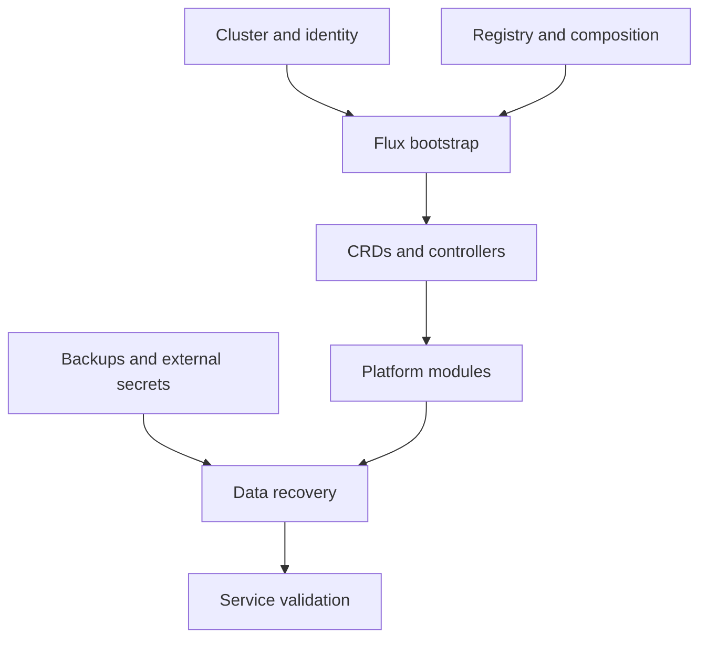

A well-organized Git repository is not a disaster recovery plan. I want to rebuild a platform on a new cluster and identify the dependencies that remain outside that process.

## Minimal bootstrap

Recovery requires a cluster, an identity able to retrieve artifacts, an available registry, composition references and a reconciliation engine. Registry and identity must not depend exclusively on the platform being restored.

## State is not an artifact

Volumes, databases, keys, DNS and external dependencies need their own procedures. Restoring database manifests does not restore data. Operator, schema and backup versions must be compatible.

Set recovery criteria before the exercise: time to usable service, freshness of restored data and functional checks. A Ready condition is insufficient.

## Reproducible experiment

On Kind, publish a composition containing a simple service and test persistent data. Back up that data outside the cluster. Destroy the disposable cluster, rebuild from digests, restore data and measure each phase. Also test an unavailable registry and a missing digest.

The result should be a report with measured durations, not an RTO promise.

## What the hub prepares for recovery

The monitoring hub uses independent OCI components, a CNPG-managed Grafana database, VictoriaMetrics and Loki with Azure object storage for Loki, and a Gateway API front end for Grafana and Alloy. Recovery also requires registry access, identities, storage classes, object storage, secrets and backups. The bootstrap script prepares prerequisites and applies the composition. We published the packages; this field experience does not establish recovery durations or a complete reconstruction result.

## Sources

- [Flux bootstrap](https://fluxcd.io/flux/installation/bootstrap/)
- [Kind](https://kind.sigs.k8s.io/)
- [Kubernetes persistent volumes](https://kubernetes.io/docs/concepts/storage/persistent-volumes/)
