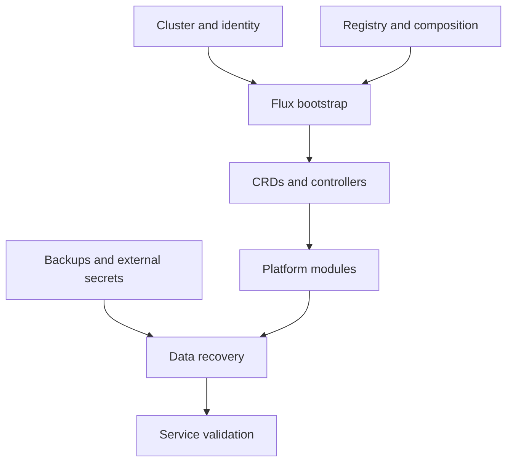

Un dépôt Git bien rangé ne constitue pas un PRA. Je veux pouvoir reconstruire une plateforme sur un cluster neuf et savoir exactement quelles dépendances subsistent hors de cette reconstruction.

## Le bootstrap minimal

Il faut un cluster, une identité capable de récupérer les artefacts, un registre disponible, les références de composition et un moteur de réconciliation. Le registre et l'identité ne doivent pas dépendre exclusivement de la plateforme qu'on cherche à restaurer.

## L'état n'est pas un artefact

Les volumes, bases de données, clés, DNS et dépendances externes nécessitent leurs propres procédures. Restaurer les manifests d'une base ne restaure pas ses données. Les versions des opérateurs, schémas et sauvegardes doivent être compatibles.

Je fixe les critères de reprise avant l'exercice : temps jusqu'au service utilisable, fraîcheur des données restaurées et contrôles fonctionnels. Une condition Ready ne suffit pas.

## Expérience à reproduire

Sur Kind, publier une composition contenant un service simple et une donnée persistante de test. Sauvegarder cette donnée hors du cluster. Détruire le cluster jetable, reconstruire à partir des digests, restaurer la donnée et mesurer chaque phase. Tester aussi un registre indisponible et un digest absent.

Le résultat doit être un rapport avec les durées réellement mesurées, pas une promesse de RTO.

## Ce que le hub permet de préparer

Le hub de monitoring utilise des composants OCI indépendants, une base Grafana gérée par CNPG, VictoriaMetrics et Loki avec stockage objet Azure, et une façade Gateway API pour Grafana et Alloy. La reconstruction nécessite aussi le registre, les identités, les classes de stockage, le stockage objet, les secrets et les sauvegardes. Le script de bootstrap prépare ces prérequis et applique la composition. Nous avons publié les paquets ; aucun temps de restauration ni résultat de reconstruction complète n'est établi par ce retour de terrain.

## Sources

- [Flux bootstrap](https://fluxcd.io/flux/installation/bootstrap/)
- [Kind](https://kind.sigs.k8s.io/)
- [Kubernetes persistent volumes](https://kubernetes.io/docs/concepts/storage/persistent-volumes/)
